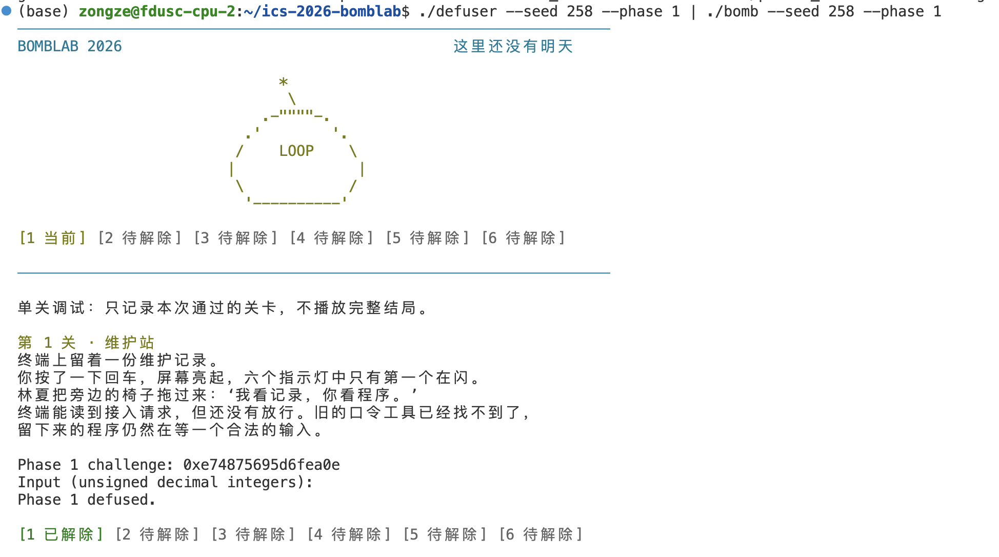
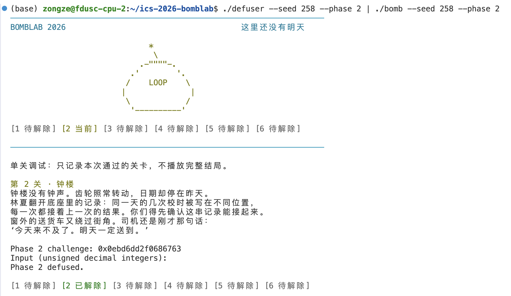
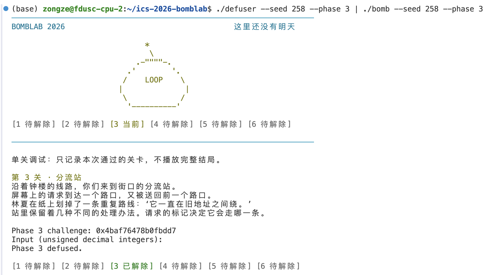
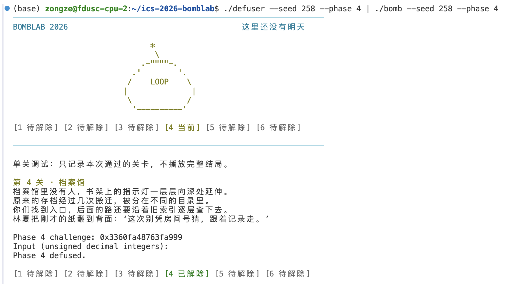
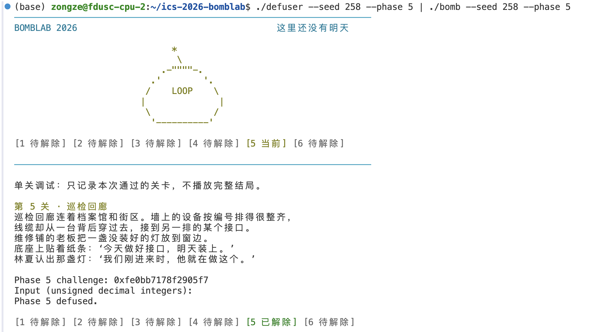
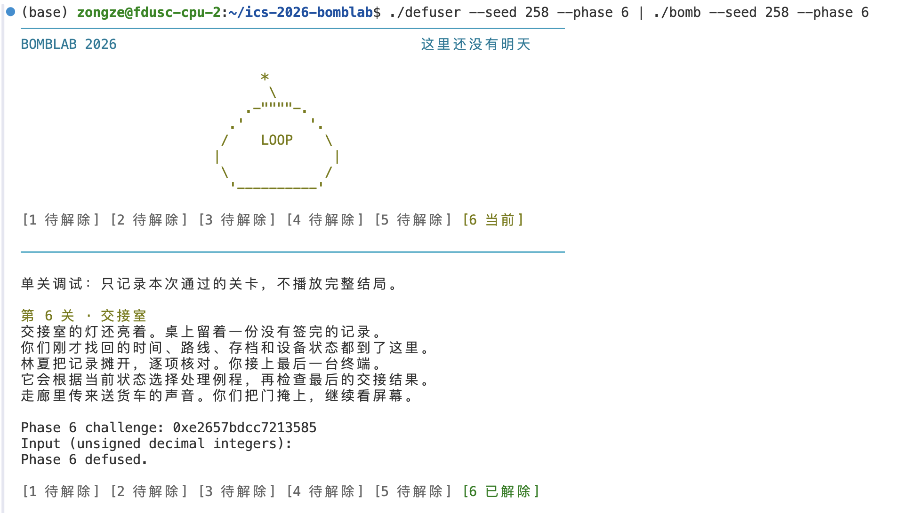
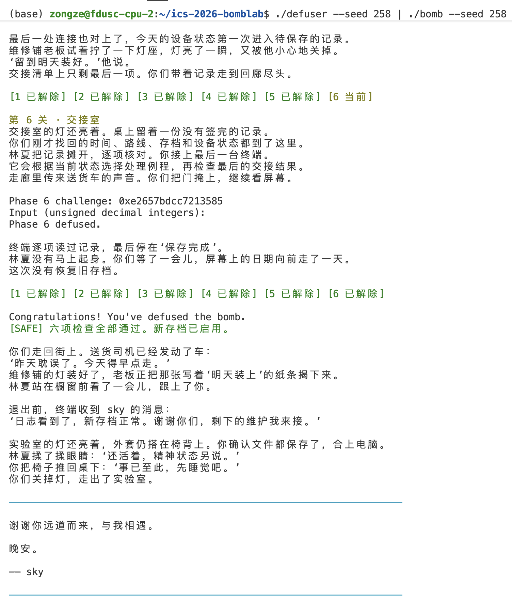

# ICS-2026-Bomblab-report

> 吴宗泽

## 所有phase实验思路简述

首先我们依据main函数确定了challenge是第二参数，在%rsi

### 1. phase1

phase1只有一个输入值，主要内容是函数调用，有phase1调用p1_compute，然后调用step0/step1/step2。具体函数内容均为一些简单的计算，此处不再赘述。

### 2. phase2

phase2涉及数组的递推关系，需要输入六个无符号32位整数。进入函数后，challenge由%rsi保存到%r13，输入字符串地址由%rdi保存到%r12。通过sscanf将六个数写入栈中从%rbp-0x40开始的连续空间，每个数占4字节。

设challenge为x，六个输入为a[0]到a[5]。首先检查第一个数：将x右移18位，取低8位后乘3。随后将%edx设为1作为下标，循环检查后五个数(-0x40(%rbp,%rdx,4))。每轮根据前一个数和challenge计算期望值，再与当前输入比较，关系如下：

```c
a[0] = 3u * ((x >> 18) & 0xffu);
for (unsigned i = 1; i < 6; ++i) {
    a[i] = 5u * (a[i - 1] + i) - ((x >> (i + 10)) & 0x1fu);
}
```

因此，defuser中先计算第一个数，再按递推关系生成其余五个数，最后按顺序输出。数组使用uint32_t保存结果，使运算结果保留低32位，与汇编中的32位运算一致。

### 3. phase3

phase3是一个switch跳转表，有两个uint32_t输入，其中一个是`x & 0x7`，也是switch的条件，第二个是switch计算的结果。

这里与前面不同的是，在p3_dispatch里面有`jmp *0x405820(,%rax,8)`，因此我们需要使用gdb查看跳转表的具体内容：

```text
(gdb) x/8gx 0x405820
0x405820:       0x0000000000402258      0x0000000000402260
0x405830:       0x0000000000402268      0x0000000000402270
0x405840:       0x0000000000402278      0x0000000000402280
0x405850:       0x0000000000402248      0x0000000000402250
```
其中8个数字对应跳转的代码行，即可找到对应的case

### 4. phase4

phase4是一个0-127的递归二分查找，在p4_walk里面有具体的跳转实现：

```c
uint32_t p4_walk(uint32_t target, uint32_t low, uint32_t high, uint32_t salt) {
    uint32_t mid = low + (high - low) / 2;
    if (target == mid) {
        return (target + 0xa4u) ^ salt;
    }
    uint32_t val = mid + salt;
    if (target < mid) {
        uint32_t r = p4_walk(target, low, mid-1, salt);
        return (3 * r) ^ val ^ 0x04u;
    } else {
        uint32_t r = p4_walk(target, mid+1, high, salt);
        return (3 * r) ^ val ^ 0x11u; 
    }
}
```

### 5. phase5

phase5是遍历一个链表，这里我们只关注p5_traverse。

首先，我们注意到`mov    0x405b60(,%rax,8),%rdx`，因此这个链表设置了8个可能的起始点(具体为`x & 0x7u`)，观察后续的遍历过程，可知次数为`x & 0x3u`。另外，根据反汇编，可以看出`%rdx` `0x8(%rdx)` `0xc(%rdx)`分别是指向下一项的指针，和两个32bit的数值。

接下来我们使用gdb查看链表的具体内容，八个起始点：

```text
(gdb) x/8gx 0x405b60
0x405b60 <p5_heads>:    0x0000000000405bc0      0x0000000000405bd0
0x405b70 <p5_heads+16>: 0x0000000000405c10      0x0000000000405c00
0x405b80 <p5_heads+32>: 0x0000000000405c20      0x0000000000405c30
0x405b90 <p5_heads+48>: 0x0000000000405bb0      0x0000000000405bf0
```

任选一个起始点依次向后查找：

```text
(gdb) x/2gx 0x405bc0
0x405bc0 <p5_nodes+32>: 0x0000000000405bd0      0x0000ca7a00000a6b
```

这里`0x0000ca7a00000a6b`就分别是链表中的两个值v2 v1

依次查找，我们发现这个链表有12项，这也印证了循环遍历`x & 0x3u`次不会溢出：

```c
struct node
{
    int next;
    uint32_t v1;
    uint32_t v2;
} nodes[] = {
    {1, 0xa6bu, 0xca7au},
    {2, 0xb32u, 0x21e0u},
    {3, 0x77du, 0xba02u},
    {4, 0x179u, 0x4979u},
    {5, 0xdu, 0x9914u},
    {6, 0x83eu, 0xbec3u},
    {7, 0x968u, 0xbf1au},
    {8, 0x308u, 0x4209u},
    {9, 0x445u, 0xb348u},
    {10, 0x27du, 0xd567u},
    {11, 0x65au, 0x4f89u},
    {-1, 0x577u, 0x25c3u},
};
```

最后，依据反汇编中的计算逻辑遍历链表算出最终答案即可。

### 6. phase6

phase6是一个函数指针表，其中p6_0~5的实现依据反汇编写出即可。

依据反汇编，p6_dispatch中`call   *0x405e00(,%rax,8)`和`call   *0x405e00(%rbx)`说明要调用两次，参数分别是`index1 = x & 0x7u, index2 = (x & 0x38u) / 8;`

使用gdb观察具体函数表:

```text
(gdb) x/8gx 0x405e00
0x405e00 <p6_ops>:      0x00000000004024f0      0x0000000000402530
0x405e10 <p6_ops+16>:   0x0000000000402540      0x0000000000402500
0x405e20 <p6_ops+32>:   0x0000000000402530      0x00000000004024e0
0x405e30 <p6_ops+48>:   0x00000000004024f0      0x0000000000402520
```

在`defuser.c`中，依据上面的跳转规则，使用switch进行实现。

### 7. secret phase

依据反汇编内容，secret函数接受的三个数字会以一定规则进行计算(具体见`defuser.c`)

字符串部分的判断在secret_gate中，观察如下这三行：

```text
  40272b:	4c 8d a5 30 ff ff ff 	lea    -0xd0(%rbp),%r12
  40277b:	81 bd 50 ff ff ff 4f 	cmpl   $0x4e45504f,-0xb0(%rbp)
  40278d:	48 8d bd 54 ff ff ff 	lea    -0xac(%rbp),%rdi
```

第一行说明输入从0xd0开始，第二行比较了0xb0和$0x4e45504f（这个是ASCII中的OPEN占4bytes），`0xb0-0xac`恰好是4，`0xd0-0xb0`是32，因此我们判断输入字符串是：

``` text
[任意32bytes内容][OPEN][三个输入数字]
```

我们只需要在输入数字前加一个`"AAAAAAAAAAAAAAAAAAAAAAAAAAAAAAAAOPEN"`即可。

## 实验结果截图









## AI使用

本试验只使用AI进行gdb/machine code含义的问答，没有使用Agent直接修改仓库中的任何内容，也没有使用Agent直接生成任何代码。